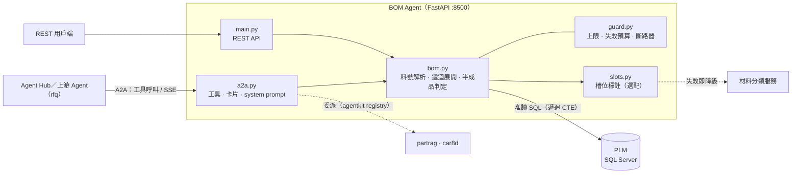
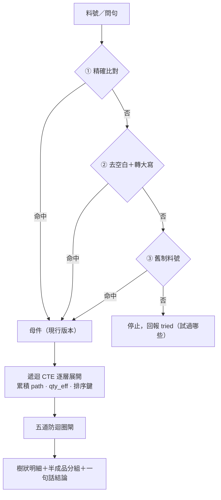

# BOM-RAG — PLM 多階 BOM 即時查詢 Agent

> **一句話介紹**：輸入一個料號，立刻展開這個產品「現在」用了哪些材料、哪些是半成品、各要幾個——每次直接查 PLM，資料永遠是最新的。

**系統導覽**：[Agent Hub（主入口）](https://github.com/LiN3simver/Agent_Hub_RAG_Frontend) · [Part-RAG](https://github.com/LiN3simver/Part-RAG) · [RFQ-RAG](https://github.com/LiN3simver/RFQ-RAG) · **BOM-RAG** · [8D-Report-RAG](https://github.com/LiN3simver/8D-Report-RAG) · [ISO-RAG](https://github.com/LiN3simver/ISO-RAG)

> **作品集展示版**：不含 SQL 查詢檔、共用框架 `agentkit` 與連線設定，無法直接執行。料號（如 `CBL-A10001-1`）與基準數值皆為虛構示意。

---

## 專案概覽

RD 換料、改版或業務報價前，常需要知道一顆成品底下的完整材料結構。BOM 資料量不大但更新頻繁，建成向量索引只會換來過期資料，所以這個 Agent **不建索引**：每次以唯讀的遞迴 SQL 即時展開 PLM 的現行 BOM，再以 REST API 與 A2A 工具提供給 LLM 及其他 Agent。

| 問法（範例） | 系統做什麼 |
|---|---|
| 「CBL-A10001-1 底下有哪些半成品？」 | 多階展開 → 依兩種定義分組列出半成品 |
| 「CBL-A10001-1 的一階 BOM 跟替代料」 | 一階明細＋每一列的替代料 |
| 「展開到第 3 層就好」 | 限深展開，並標示結果是否完整 |

## 核心功能

- **多階展開**：一路展開到最底層（上限 12 層），用量逐層累乘並計入損耗率
- **半成品判定**：分開輸出「結構事實（自己還有 BOM）」與「PLM 登記值」，不把標籤、沖壓件誤判成半成品
- **替代料**：掛在每一條明細列上，而不是料號上
- **有界執行**：遞迴深度、列數、逾時、失敗次數都有上限，超出就停並說明原因

## 系統架構



## 檢索流程

這裡的「檢索」不是向量搜尋，而是**確定性的識別碼解析＋遞迴展開**。



- **刻意不做模糊比對**：拿猜出來的料號展開 BOM，會得到一張看起來完整、其實不是使用者要的表。解析梯每一步都吃一次失敗預算，三步都失敗就停。
- **遞迴展開時每一列同時累積**：`path`（root 到此列的料號路徑，用來偵測環）、`qty_eff`（逐層累乘「用量 ×（1 + 損耗率 / 100）」）、逐層補零的排序鍵（排序後即為深度優先，不同分支不會交錯）。
- **五道防迴圈閘**（上限集中在 [src/guard.py](src/guard.py)）：

| # | 防護 | 作用 |
|---|---|---|
| ① | 自環過濾 | 排除母件＝子件的明細（資料中確實存在） |
| ② | 路徑環偵測 | 子件已在 `path` 中就不再展開（防 A→B→A） |
| ③ | 深度上限 | 12 層 |
| ④ | 資料庫遞迴硬上限 | 20 層，刻意高於 ③；觸發代表邏輯有錯，寧可中斷 |
| ⑤ | 列數上限 | 5,000 列，超過即截斷並標記 `truncated` |

## 驗證機制

這個 Agent 的輸出全部來自 SQL，驗證重點是「資料本身對不對、結果完不完整」：

- **自我測試**：`python -m src.bom --selftest` 共 13 項——4 項基準值（展開列數、子件種類…）、4 項迴圈與失敗預算防護、5 項已知答案；另以 `_is_depth_first` 檢查輸出順序
- **完整性誠實回報**：截斷判斷在過濾之前做；`rows_scanned` 區分「這顆料沒有 BOM」與「有 BOM 但沒有符合篩選的列」
- **每支工具都附 `answer`**：一句可讀結論，即使小模型直接貼出原始 JSON，使用者仍看得到正確答案
- **未完成的能力不假裝可用**：`propose_bom`、`get_slot_template` 以 `ready=False` 宣告，名片狀態標為 `degraded` 並列出 `blocked_by`

## Agent 協作

| 項目 | 內容 |
|---|---|
| Agent ID | `bom` |
| 上游（誰會呼叫我） | `rfq` 產品估價 |
| 下游（我可以問誰） | `partrag` 相似料號、`car8d` 8D 客訴（由 agentkit registry 掛載，呼叫圖單向無環） |
| 工具 | `get_bom`（多階展開）、`get_bom_line`（一階＋替代料）、`find_semi_finished`（半成品） |
| 預先查詢 tags | `BOM`、`槽位`、`用量` |

- **槽位標註可降級**：每個不重複的子件呼叫一次材料分類服務、只快取成功結果；連續失敗 3 次即斷路，槽位欄位留 `null` 而不是猜測，主答案不受影響
- **失敗預算**：每次請求最多失敗 3 次就停，不做無意義重試

## 技術重點

| 資料陷阱 | 做法 |
|---|---|
| BOM 明細的「現行」旗標 ≠ 母件是現行版本 | 另外過濾母件版本；少了這一步，舊版明細會混入，數量膨脹數倍且不會報錯 |
| 部分明細指向子件的舊版本 | 以料號接回子件的現行版本，避免漏展 |
| 損耗率是百分比，不是小數 | 統一以 `/ 100` 換算，避免用量被灌大數倍 |
| 旗標欄位存成字串 `'0'`／`'1'` | 統一轉成布林；字串 `'0'` 在 Python 是真值 |
| 虛擬件（phantom） | 照常穿透展開，但保留並標記 `is_phantom` |

## 量化成果

| 指標 | 數值 |
|---|---|
| 最大單張 BOM 展開 | 約 1,500 列，約 0.06 秒 |
| 展開深度 | 最深 12 層 |
| 自我測試 | 13 項 |

> 時間與列數為原系統在內部資料上的量測；展示版不含資料，無法重現。

## 技術堆疊

| 類別 | 使用 |
|---|---|
| 服務 | Python 3.12、FastAPI、Uvicorn、httpx |
| 資料 | SQL Server（PLM，唯讀）、pyodbc、遞迴 CTE |
| LLM | Anthropic Messages API 相容 gateway（`anthropic` SDK） |
| 多 Agent | agentkit（A2A 契約，維護於 [Agent Hub](https://github.com/LiN3simver/Agent_Hub_RAG_Frontend)） |

## 專案結構

```
main.py          FastAPI 入口與 REST 端點
src/bom.py       料號解析、多層展開、一階明細、半成品判定、selftest
src/a2a.py       A2A 工具定義、檢索卡片、LLM system prompt
src/guard.py     失敗預算、斷路器、各項上限（單一設定來源）
src/slots.py     呼叫材料分類服務標註槽位（快取＋斷路器）
src/db.py        SQL Server 唯讀連線
```

| Method | Path | 說明 |
|---|---|---|
| GET | `/api/bom/{item_number}` | 多層展開（`?level=` `?rows=` `?like=` `?slots=`） |
| GET | `/api/bom/{item_number}/semi` | 半成品（依兩種定義分組） |
| GET | `/api/bom/{item_number}/line` | 一階明細＋替代料 |
| GET | `/api/health` | 來源庫／下游／LLM 狀態 |
| POST | `/a2a/tool/{name}` · `/a2a/message` | A2A 工具呼叫、委派型對話（SSE） |

## 展示版範圍

- **未收錄**：`sql/*.sql`（料號解析、一階明細、多層展開三支查詢）、`agentkit`、`.env`
- **設計說明**：版本過濾、自環／路徑環偵測與 `qty_eff` 累乘實作在 SQL 內，本文件以文字說明
- 料號、基準值與統計皆為虛構或經去識別化
